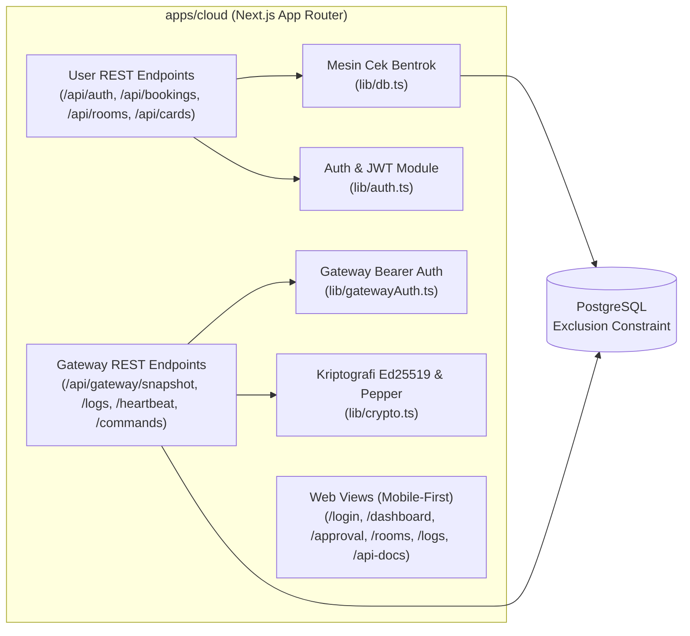
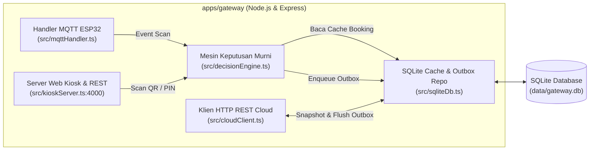
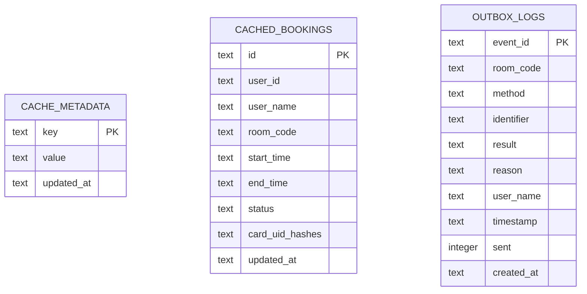
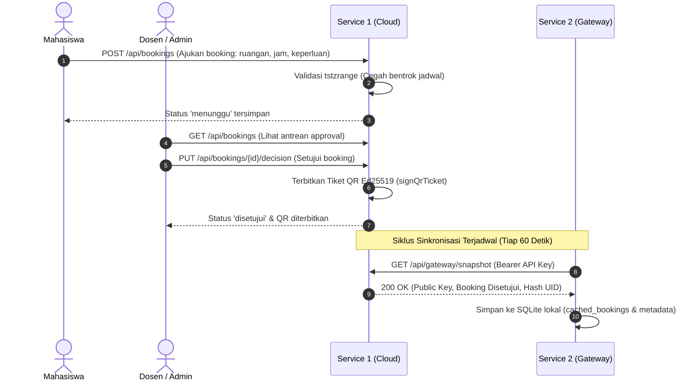
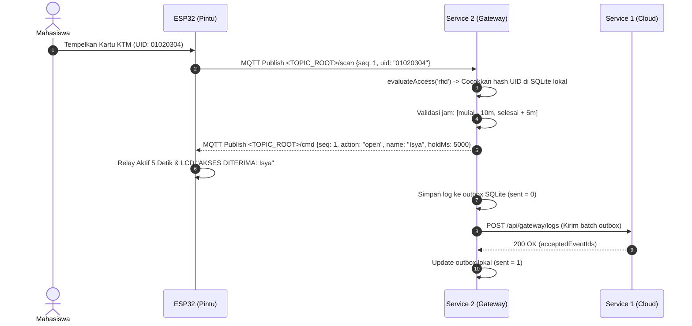
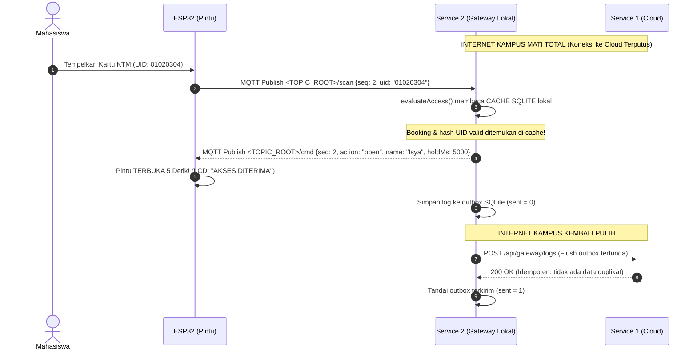
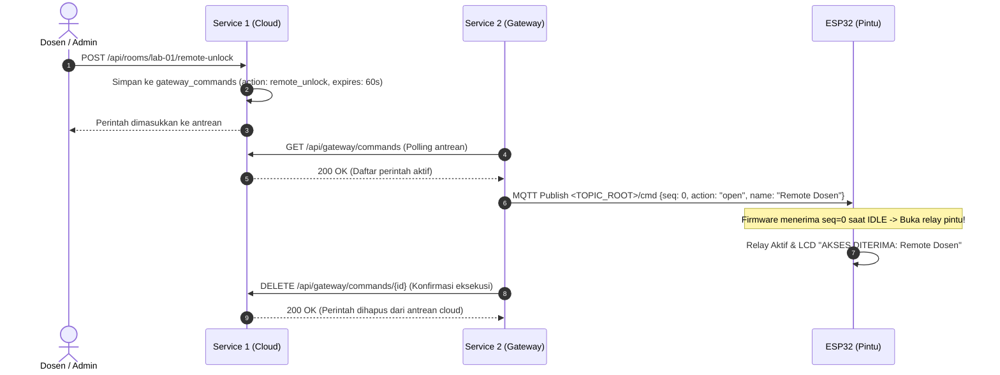

# Desain Arsitektur dan Diagram Sistem LabGate (docs/ARSITEKTUR.md)

Dokumen ini menyajikan arsitektur lengkap sistem terintegrasi **LabGate**, mencakup diagram konteks, diagram komponen, entity-relationship diagram (ERD), skema SQLite lokal, diagram sekuensial alur bisnis, serta arsitektur deployment.

---

## 1. Diagram Konteks / Arsitektur Sistem

Sistem terdiri dari **DUA Service mandiri** yang berkomunikasi murni melalui protokol HTTP REST, serta **satu perangkat periferal IoT fisik/simulasi (ESP32)** yang berbicara ke Gateway lokal menggunakan protokol MQTT.

> **PENEGASAN ARSITEKTUR**: ESP32 **BUKAN** merupakan service independen, melainkan periferal mikrokontroler penggerak relay solenoid pintu dan pembaca sensor RFID. Dua service yang dinilai dalam tugas adalah **Service 1 (Cloud)** dan **Service 2 (Gateway Lokal)**.

```mermaid
flowchart TB
    subgraph PENGGUNA["Pengguna Sistem"]
        MHS["Mahasiswa (Laptop/Smartphone)"]
        DOSEN["Dosen Pembimbing & Admin Lab"]
    end

    subgraph CLOUD_ENV["Platform Cloud (Vercel)"]
        S1["SERVICE 1: Web Booking & Approval (Next.js 14)\nREST API Server"]
        DB_CLOUD[("Database Relasional\nPostgreSQL (Neon)")]
        S1 <--> DB_CLOUD
    end

    subgraph LOCAL_GATE["Perangkat Depan Pintu Lab (Mini PC / Laptop Kiosk)"]
        S2["SERVICE 2: Edge Gateway & Kiosk UI (Port 4000)\nREST API Client & Server"]
        DB_LOCAL[("Offline Cache & Outbox\nSQLite (better-sqlite3)")]
        S2 <--> DB_LOCAL
    end

    subgraph PERIFERAL_PINTU["Pintu Fisik Laboratorium"]
        ESP["Perangkat Mikrokontroler (ESP32)\nRFID RC522 + LCD 16x2 + Relay Solenoid"]
        BROKER["MQTT Broker\n(Local Mosquitto / HiveMQ Wokwi)"]
        ESP <-->|Protokol MQTT| BROKER
        BROKER <-->|Protokol MQTT| S2
    end

    MHS -->|HTTP REST (Browser)| S1
    DOSEN -->|HTTP REST (Browser)| S1
    S2 <==>|HTTP REST Inter-Service (GET, POST, PUT, DELETE)| S1
    MHS -.->|Scan Tiket QR Kamera| S2
    MHS -.->|Tap Fisik KTM RFID| ESP

    classDef serviceNode fill:#1e3a8a,stroke:#3b82f6,stroke-width:2px,color:#ffffff;
    classDef edgeNode fill:#0f172a,stroke:#10b981,stroke-width:2px,color:#ffffff;
    classDef deviceNode fill:#334155,stroke:#f59e0b,stroke-width:2px,color:#ffffff;
    class S1 serviceNode;
    class S2 edgeNode;
    class ESP,BROKER deviceNode;
```

---

## 2. Diagram Komponen Service

### 2.1. Komponen Service 1: Cloud (`apps/cloud`)


### 2.2. Komponen Service 2: Gateway Lokal (`apps/gateway`)


---

## 3. Entity-Relationship Diagram (ERD) & Skema Data

### 3.1. ERD Cloud (PostgreSQL)
```mermaid
erDiagram
    USERS ||--o{ BOOKINGS : "mengajukan"
    USERS ||--o{ CARDS : "memiliki"
    ROOMS ||--o{ BOOKINGS : "dijadwalkan di"
    ROOMS ||--o{ EQUIPMENT : "menyediakan"
    ROOMS ||--o{ ACCESS_LOGS : "mencatat di"
    ROOMS ||--o{ GATEWAY_COMMANDS : "menerima perintah"
    EQUIPMENT ||--o? BOOKINGS : "dipinjam pada"

    USERS {
        varchar id PK
        varchar name
        varchar email UK
        varchar password_hash
        varchar role
        varchar department
        varchar nim
        timestamptz created_at
    }

    ROOMS {
        varchar id PK
        varchar code UK
        varchar name
        int capacity
        varchar api_key_hash UK
        boolean is_active
        timestamptz last_seen
        timestamptz last_sync
        varchar version
        int queue_count
    }

    CARDS {
        varchar id PK
        varchar user_id FK
        varchar uid_hash UK
        varchar label
        boolean is_active
        timestamptz created_at
    }

    EQUIPMENT {
        varchar id PK
        varchar room_id FK
        varchar name
        varchar code UK
        boolean is_available
    }

    BOOKINGS {
        varchar id PK
        varchar user_id FK
        varchar room_id FK
        varchar equipment_id FK
        text purpose
        timestamptz start_time
        timestamptz end_time
        varchar status
        text rejection_reason
        text qr_token
    }

    ACCESS_LOGS {
        varchar id PK
        varchar event_id UK
        varchar room_id FK
        varchar user_id FK
        varchar method
        varchar identifier
        varchar result
        varchar reason
        varchar user_name
        timestamptz timestamp
    }

    GATEWAY_COMMANDS {
        varchar id PK
        varchar room_id FK
        varchar action
        jsonb payload
        varchar status
        timestamptz expires_at
        timestamptz created_at
    }
```

### 3.2. Skema SQLite Gateway Lokal (`better-sqlite3`)


---

## 4. Diagram Sekuensial Alur Operasional

### 4.1. Alur Pengajuan Booking, Approval Dosen, dan Sinkronisasi Gateway


### 4.2. Alur Tap Kartu RFID Saat Online


### 4.3. Alur Tap Kartu Saat Internet Kampus Mati (Offline Resilience)


### 4.4. Alur Buka Pintu Jarak Jauh (Remote Unlock via Commands)


---

## 5. Diagram Deployment

```mermaid
flowchart TD
    subgraph CLOUD_INFRA["Infrastruktur Cloud (Production)"]
        VERCEL["Vercel Serverless Hosting\n- Service 1: Next.js 14 App Router\n- Domain Publik (HTTPS)\n- REST API Endpoint & Swagger UI (/api-docs)"]
        NEON_PG[("Neon Serverless PostgreSQL\n- Basis Data Relasional\n- Exclusion Constraint (tstzrange)\n- Backup Otomatis & SSL Connection")]
        VERCEL <-->|DATABASE_URL (SSL)| NEON_PG
    end

    subgraph LOCAL_INFRA["Infrastruktur Lokal (Gedung Lab Kampus)"]
        MINI_PC["Mini PC / Laptop Gate Scanner\n- Service 2: Node.js/TypeScript (Port 4000)\n- Layar Kiosk & Webcam QR Scanner (Browser)\n- SQLite Local Database (data/gateway.db)"]
        MQTT_BROKER["MQTT Broker\n(Mosquitto Lokal Port 1883 / HiveMQ)"]
        ESP32_DEVICE["ESP32 Microcontroller\n- Sensor RFID-RC522 (SPI)\n- LCD Display 16x2 (I2C)\n- Relay Solenoid Kunci Pintu (GPIO 26)"]
        
        MINI_PC <-->|TCP Port 1883| MQTT_BROKER
        ESP32_DEVICE <-->|WiFi 802.11 b/g/n| MQTT_BROKER
    end

    MINI_PC <==>|HTTP/HTTPS REST (Bearer API Key)| VERCEL
```
